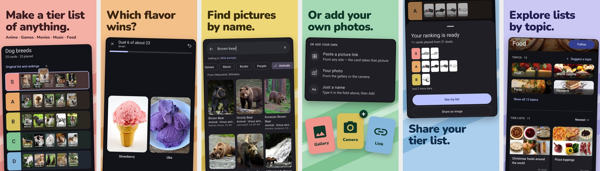
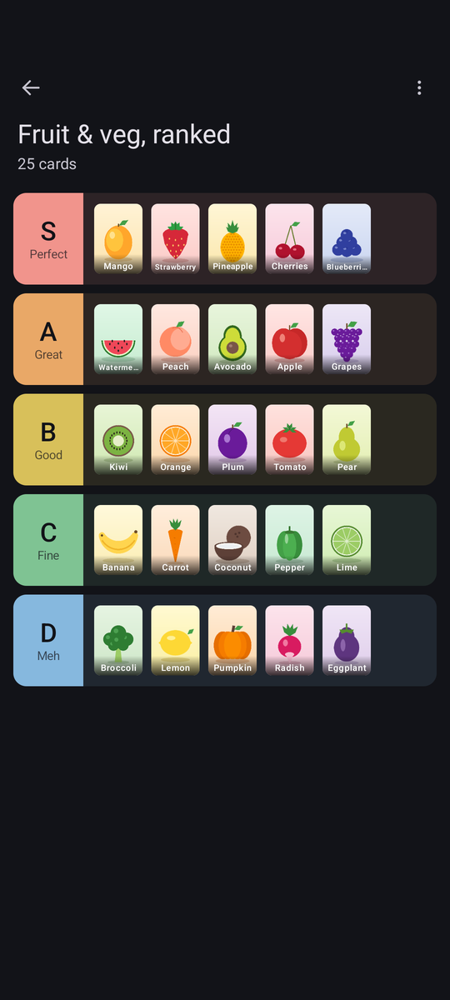
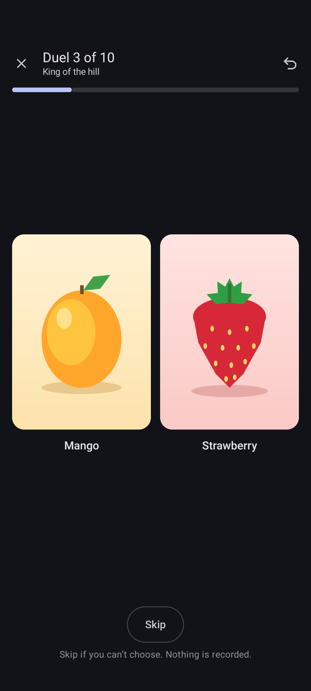
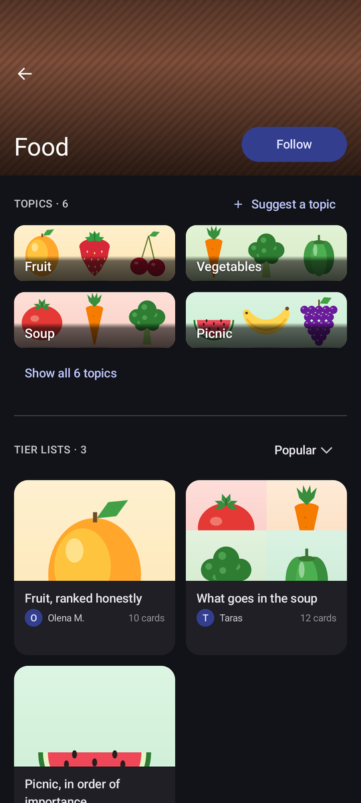
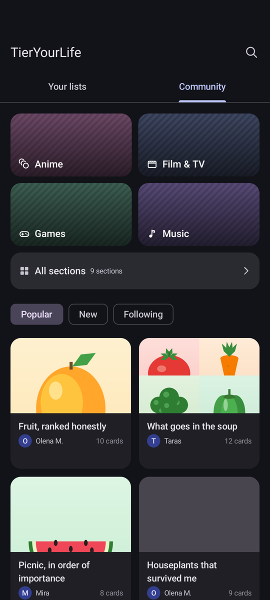
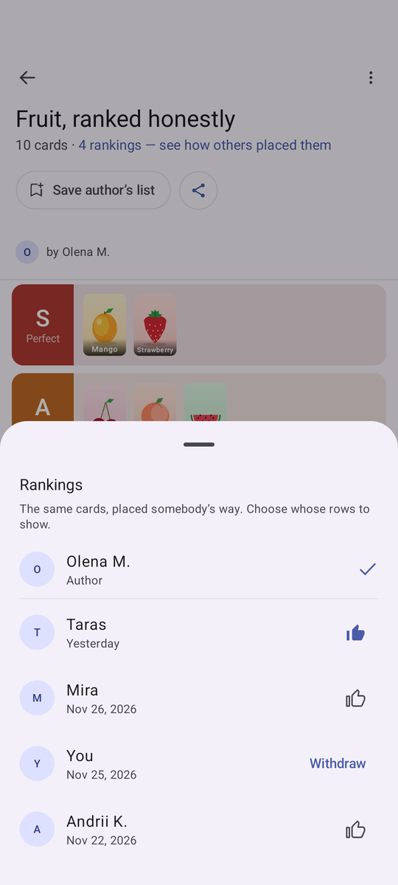
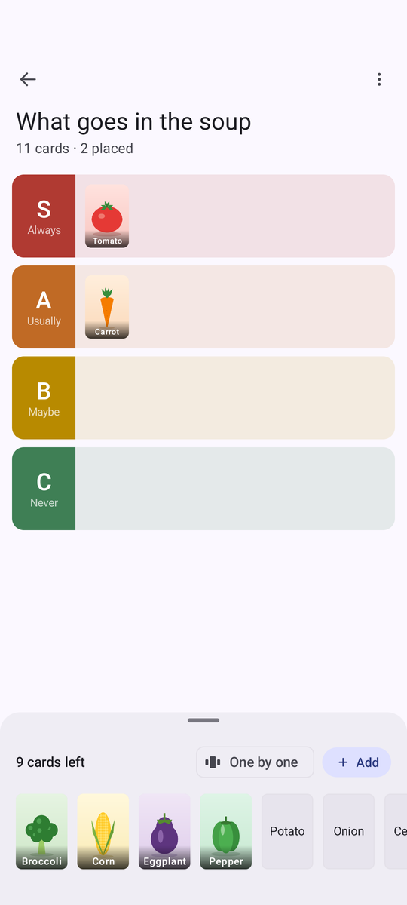
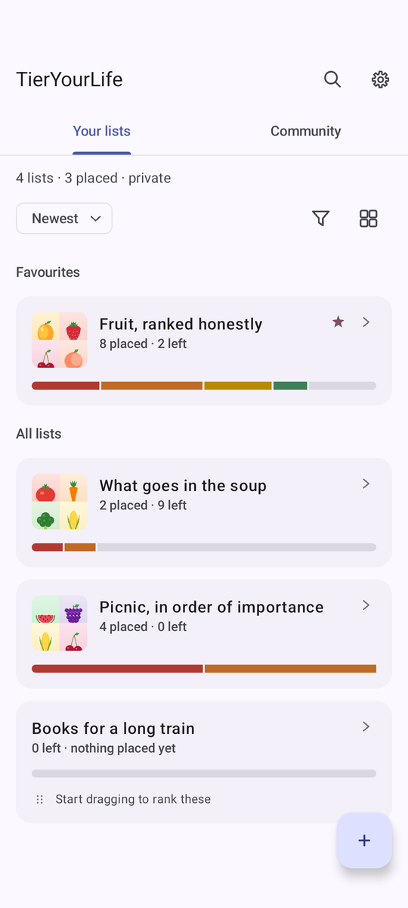
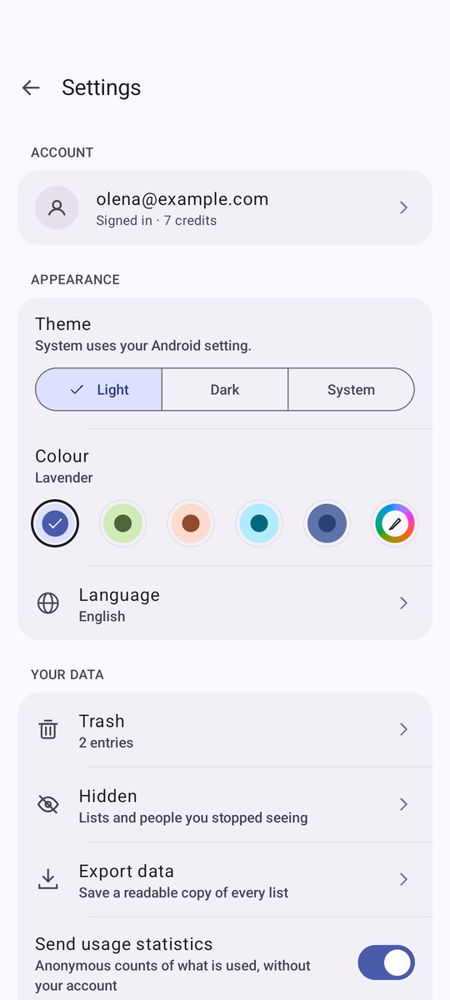

<h1 align="center">TierYourLife</h1>

  <b>Rank anything from S to D. Can't decide? Duel it out.</b> 
  A tier list maker for anime, games, movies, music and food. Free, with no ads.

  <a href="https://tieryourlife.com"><b>Open tieryourlife.com</b></a>
  &nbsp;·&nbsp;
  Android: coming to Google Play, in closed testing now

  

## What you can do

- **Make a tier list in a minute.** Drag cards into S, A, B, C and D. Add or remove tiers, or switch to a plain top 10.
- **Type a name, get the picture.** Films, shows, anime, games, books, people, plants and animals. Or use your own photo or a link.
- **Duel it out.** Any list becomes a "this or that" game: tap the card you like more and the tiers fill in by themselves. There are four ways to play.
- **See how others ranked it.** Open someone's list, rank the same cards your way, and compare the versions.
- **Browse by topic.** Anime, film and TV, games, music, books, food, sport, people and more.
- **Share it** as a picture or a link.
- **Keep it everywhere.** Sign in with Google and your lists follow you to a new phone and to the website. You can start without an account.

Light and dark themes, eleven languages.

## The app

  
  
  
  

A board · a duel · a section with its topics · the community

  
  
  
  

Everyone's rankings of one list · cards still to place · your lists · settings

## Three repositories

| | Repository | Where it runs |
|---|---|---|
| **Android app** | this one: Kotlin, Jetpack Compose | Google Play, in closed testing |
| **Website** | [tieryourlife-web](https://github.com/kellygracelab-dotcom/tieryourlife-web): React, TypeScript | [tieryourlife.com](https://tieryourlife.com) |
| **Server** | [tieryourlife-proxy](https://github.com/kellygracelab-dotcom/tieryourlife-proxy): Cloud Functions in front of Firestore | behind both |

## For developers

- [How it is built](docs/engineering.md): the modules, five files worth reading, and the tests.
- [Building it yourself](docs/building.md).
- [Design specs](docs): why each screen looks the way it does.
- [Release to Google Play](docs/play-internal-delivery.md).
- [Where these pictures come from](docs/screenshots.md).

AI agents wrote a large share of the code against my specifications. The specifications,
architecture decisions, code review and testing on a real phone are mine.

---

Photo credits for the pictures above: <a href="https://tieryourlife.com/store-credits">tieryourlife.com/store-credits</a>. This product uses the TMDB API but is not endorsed or certified by TMDB.
